<p align="center">
  
</p>

# cipher-exec

Kernel-isolated execution sandbox for untrusted code execution.

Built in Go using native Apple Seatbelt (`sandbox-exec`) on macOS and Linux namespaces (`unshare`) and cgroups v2. Runs without Docker or external container runtimes.

Looking for a plain-English, non-technical summary? See [EXPLAINER.md](EXPLAINER.md).

---

## Security Invariants

| Invariant | Mechanism | Enforcement |
| :--- | :--- | :--- |
| **Network Isolation** | `(deny network*)` / `unshare -n` | Sockets, network devices, and packet transmission denied. |
| **Filesystem Boundary** | Ephemeral scratchpad directory | Read-only system libraries, isolated temp dir wiped on exit. |
| **Timeout Ceiling** | Process-group `SIGKILL` | Runaway processes killed in $\le 3001\text{ms}$. |
| **Local Boundary** | Unix socket `/tmp/cipher/exec.sock` | File permissions pinned to `0600`. |

---

## Build

```bash
go build -o cipher-exec .
```

---

## Usage

```bash
./cipher-exec --port 8081 --socket /tmp/cipher/exec.sock
```

### Endpoints

#### `POST /execute`

Executes candidate code within the sandbox.

Request:
```json
{
  "language": "python",
  "code": "print(2 + 2)",
  "timeout_seconds": 3
}
```

Response (Success):
```json
{
  "status": "success",
  "exit_code": 0,
  "stdout": "4\n",
  "stderr": "",
  "execution_time_ms": 41.2
}
```

Response (Timeout):
```json
{
  "status": "timeout",
  "exit_code": -1,
  "stdout": "",
  "stderr": "Execution exceeded timeout ceiling (3s). Process group terminated.",
  "execution_time_ms": 3001.0
}
```

---

## License

MIT License. Copyright (c) 2026 Shlok Tiwari.
